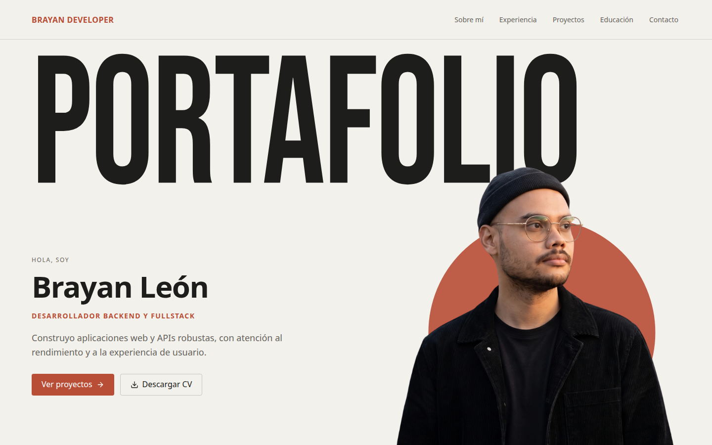
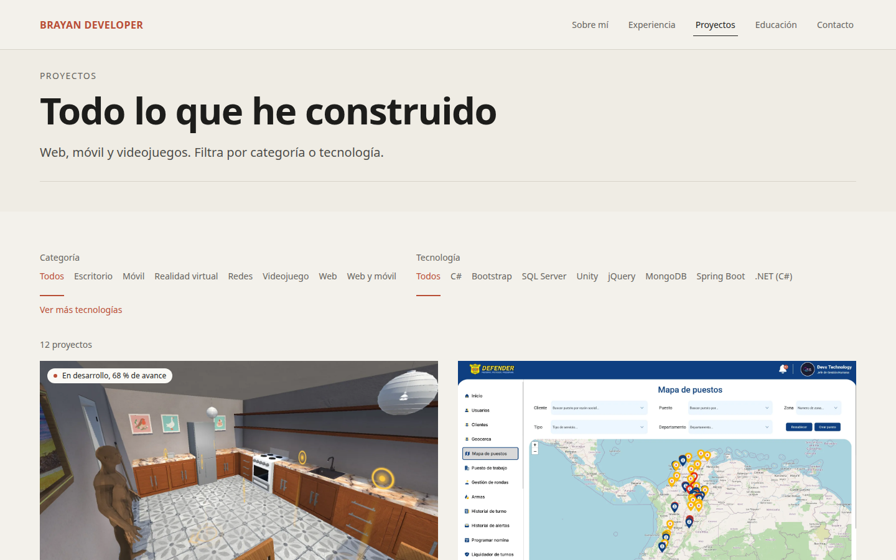
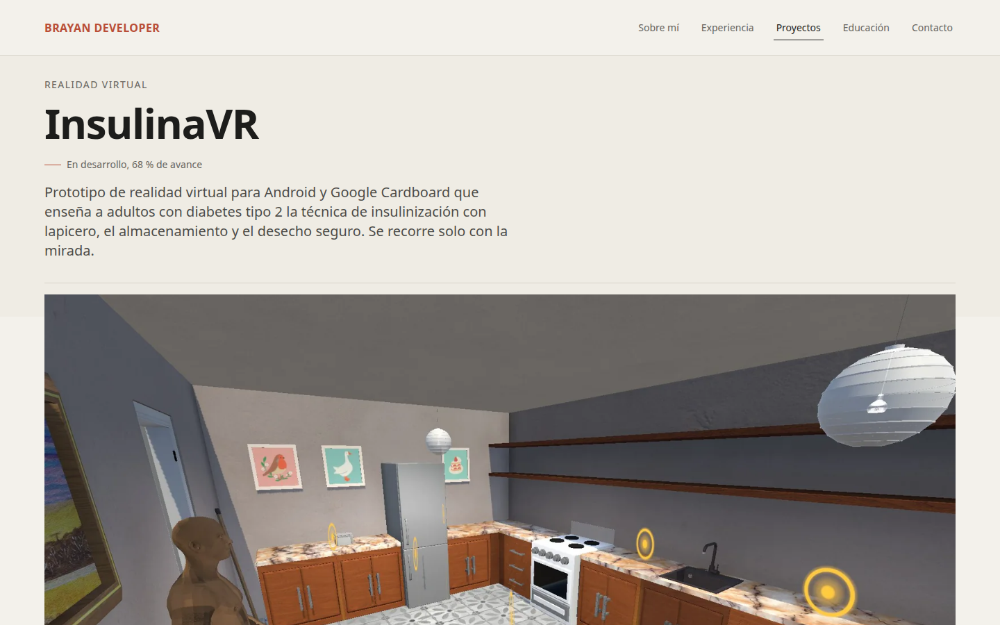
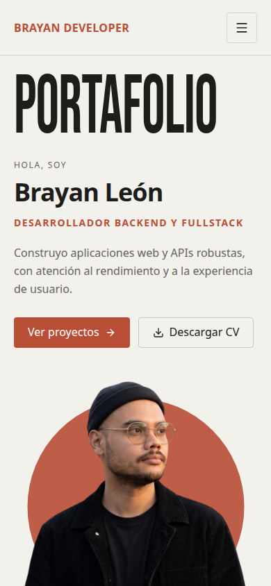

# Portafolio de Brayan Steven León Martinez


Portafolio de **Brayan Steven León Martinez**, estudiante de Ingeniería de Sistemas en la Universidad Autónoma de Bucaramanga (UNAB), desarrollador Fullstack con enfoque en Backend que busca prácticas profesionales para 2027-1. Presenta experiencia, capacidades técnicas, formación y 12 proyectos con sus respectivos casos de estudio.

## Vista previa

| Inicio — escritorio (1440 × 900) | Proyectos — escritorio (1440 × 900) |
|---|---|
|  |  |

| InsulinaVR — escritorio (1440 × 900) | Inicio — móvil (390 × 844) |
|---|---|
|  |  |

## Qué incluye

- **Inicio editorial** con presentación, estadísticas, capacidades, proyectos destacados, formación y contacto.
- **Experiencia** en filas editoriales con fechas, responsabilidades, tecnologías y referencias laborales.
- **12 proyectos**, seis destacados en Inicio, con filtros compartibles por categoría y tecnología.
- **Casos de estudio** con narrativa por secciones, datos del proyecto, stack, enlaces y navegación al proyecto siguiente.
- **Galerías** con imágenes reales cuando están disponibles; las ideas visuales pendientes se identifican explícitamente como propuestas. El carrusel incluye controles de teclado y visor ampliado.
- **Educación** con formación académica y certificados filtrables.
- **Contacto** con opción para copiar el correo, WhatsApp, descarga del CV y enlaces sociales.
- Navegación móvil, foco visible y movimiento que respeta `prefers-reduced-motion`.

## Rutas

| Ruta | Contenido |
|---|---|
| `/` | Portafolio y secciones principales |
| `/experiencia` | Experiencia laboral |
| `/proyectos` | Archivo completo con filtros |
| `/proyectos/:slug` | Caso de estudio de cada proyecto |
| `/educacion` | Formación y certificados |

## Tecnologías

| Área | Herramientas |
|---|---|
| Interfaz | React 19, TypeScript 6, React Router 7 |
| Estilos y tipografía | Tailwind CSS 4; Bebas Neue, Outfit, DM Sans e IBM Plex Mono |
| Movimiento | Motion y GSAP |
| Iconos | lucide-react y simple-icons |
| Desarrollo y build | Vite 8, tsx y oxlint |
| Analítica | Vercel Web Analytics y Speed Insights |
| Despliegue | Vercel |

## Estructura

```text
src/
├── app/          Aplicación y rutas con carga diferida
├── components/
│   ├── layout/   Navegación, contenedores y pie de página
│   ├── ui/       Controles y componentes reutilizables
│   └── bits/     Componentes visuales compartidos
├── features/     home, about, experience, projects, education, stack y contact
├── pages/        Composición de las rutas
├── data/         Contenido editable del portafolio
├── hooks/        Hooks de metadatos y navegación
├── styles/       Estilos globales y tokens
└── types/        Tipos compartidos
public/
├── projects/     Imágenes de los proyectos
├── assets/       Recursos del sitio
└── cv-brayan-leon.pdf
scripts/          Generación de HTML y metadatos SEO
docs/             Capturas actuales incluidas en este README
DESIGN.md         Contrato visual vigente
```

## Primeros pasos

Requisitos: Node.js 22.12 o superior y npm.

```bash
npm install
npm run dev
```

| Comando | Qué hace |
|---|---|
| `npm run dev` | Servidor de desarrollo en `http://localhost:5173` |
| `npm run build` | Comprueba tipos, compila y genera las páginas y metadatos SEO |
| `npm run preview` | Sirve localmente el build de producción |
| `npm run lint` | Revisa el código con oxlint |

## Cómo editar el contenido

El contenido del portafolio vive en archivos de datos:

| Quiero cambiar | Archivo |
|---|---|
| Nombre, redes, correo, CV y menú | `src/data/site.ts` |
| Proyectos, casos de estudio y galerías | `src/data/projects.ts` y `public/projects/<slug>/` |
| Experiencia laboral | `src/data/experience.ts` |
| Estudios | `src/data/education.ts` |
| Certificados | `src/data/certifications.ts` |
| Capacidades y herramientas | `src/data/stack.ts` |
| Presentación y recorrido | `src/data/about.ts` |
| Títulos y descripciones de las páginas | `src/data/seo.ts` |

Para sumar un proyecto, agrega un objeto a `projects` con `slug`, `title`, `category`, `description` y `stack`. También puedes añadir secciones narrativas, enlaces, una portada y una galería. Las rutas, los filtros, el sitemap y los metadatos se generan desde esos datos.

### Fecha de publicación y proyectos destacados

Ambas cosas se editan por proyecto en `src/data/projects.ts`:

| Campo | Qué hace | Dónde se ve |
|---|---|---|
| `publishedAt: 'AAAA-MM-DD'` | Fecha de publicación o ejecución. Ordena todos los listados de más reciente a más antigua. Sin este campo, el proyecto queda al final del orden. | Ficha lateral del proyecto, como «oct 2026» |
| `featured: true` | Marca el proyecto como destacado. | Solo los destacados aparecen en Inicio y en el pie de página |

El orden y la lista de destacados se calculan una sola vez al final de `src/data/projects.ts` (`projectsByDate` y `featuredProjects`), así que no hay que ordenar nada a mano en los componentes: basta con cambiar `publishedAt` y `featured` en cada proyecto.

## Diseño y accesibilidad

La dirección visual es editorial neo-minimalista: papel `#F3F1EB`, superficie `#FAF9F5`, tinta `#1D1D1B` y terracota `#B94E36`. Bebas Neue forma el masthead; Outfit se usa en titulares, DM Sans en texto e IBM Plex Mono en etiquetas técnicas. Los tokens están en `src/styles/index.css` y las reglas vigentes en [`DESIGN.md`](DESIGN.md).

La interfaz usa estructura semántica, foco visible, navegación por teclado y respeta `prefers-reduced-motion`.

## SEO

`npm run build` ejecuta `tsc`, `vite build` y `scripts/generate-seo.mjs`. El generador crea HTML con título, descripción, canonical, Open Graph, Twitter y JSON-LD para cada ruta, además de `sitemap.xml` y `robots.txt`. Las páginas de detalle se construyen desde los datos de los proyectos.

La dirección canónica sale de `SITE_URL`; si no se define, se usa `https://brayandeveloper.online`. El PDF del CV recibe `X-Robots-Tag: noindex, noarchive`. La configuración de Vercel está en `vercel.json`.

## Despliegue en Vercel

Vercel compila con `npm run build` y sirve `dist`. `vercel.json` conserva las rutas de la SPA, los headers de seguridad y las reglas de caché. Después del despliegue se pueden comprobar `/sitemap.xml`, `/robots.txt` y las vistas previas sociales de las rutas de proyecto.

## Analítica

El sitio integra [Vercel Web Analytics](https://vercel.com/docs/analytics) y [Speed Insights](https://vercel.com/docs/speed-insights). En local no se montan los componentes de medición para no mezclar pruebas con visitas reales. Para ver datos de producción, activa ambas herramientas en el proyecto de Vercel.

## Autor

**Brayan Steven León Martinez**, estudiante de Ingeniería de Sistemas en la Universidad Autónoma de Bucaramanga.

- GitHub: [@bleon133](https://github.com/bleon133)
- LinkedIn: [Brayan Steven León Martinez](https://www.linkedin.com/in/brayan-steven-le%C3%B3n-martinez-a7528416b)

## Licencia

Todos los derechos reservados. El contenido, las capturas de proyectos y el CV son personales. El código puede consultarse como referencia, pero no se autoriza a copiar el sitio completo como portafolio propio.
